<h1 align="center">ATTRITION – Free Hardcore Tactical FPS & Extraction Shooter for Windows</h1>

<b>A free, Tarkov-like extraction shooter for Windows: take your own gear into a fully destructible voxel city, fight hundreds of smart AI soldiers, tanks and drones alone, in co-op or PvP – and lose it all if you don't make it back.</b>

✔ 100 % free · ✔ no account, no launcher, no ads · ✔ offline single-player + online co-op · ✔ auto-updates

<b>How to install (1 minute):</b> ① click the green button to download <code>ATTRITION-Windows.zip</code> · ② right-click → <i>Extract All</i> · ③ open the folder and start <code>ATTRITION.exe</code>. Updates install automatically. 
Windows may show “Windows protected your PC” – click <i>More info → Run anyway</i> (the game is not code-signed yet). Ignore the many single files on the release page – they are only for the auto-updater.

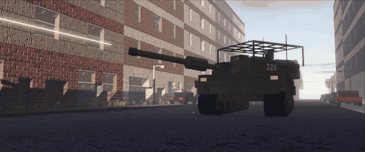

 ▶ <a href="https://www.youtube.com/watch?v=Mkiqu9hALas">Watch the trailer on YouTube</a>

<a href="#latest-updates">Latest updates</a> · <a href="CONTRIBUTING.md">Report a bug</a>

⭐ <b>Like it? Star the repo</b> – it helps other players find the game and keeps updates coming.

> [!IMPORTANT]
> **Early alpha – expect bugs and frequent updates.** New versions often ship several times a day, and the game installs them by itself.
>
> **Language:** the game is in German for now. An English version is on the way. Menus and the HUD are short and work fine without German.

---

## 🎯 About the game

You are one soldier in a war that keeps going without you. Four factions fight over a city with hundreds of AI soldiers, tanks, helicopters and drones, and every wall can be shot through or blown apart.

What you take into a fight is yours to lose. You draw a free standard kit, or you go in with gear you bought or looted. If you die, it stays on your body, and whoever gets there first can take it. If you make it back, you keep everything and get paid for what you did out there.

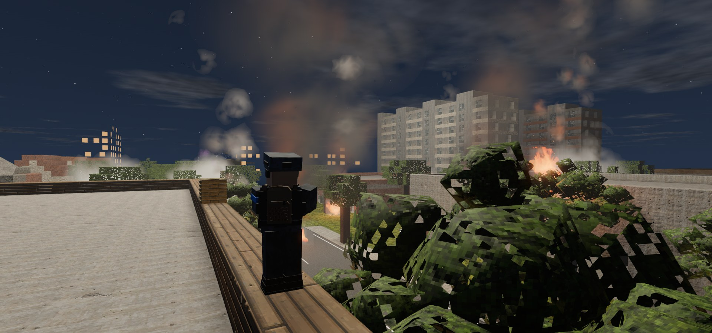

## ✨ Features

<table>
<tr>
<td width="50%" valign="top">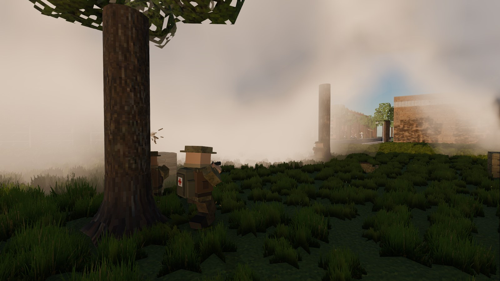 <b>A war that fights back</b> The AI works in squads: it takes cover, throws smoke to cross open ground or to pull a wounded man out, and shoots at radio operators and leaders first. It only knows what it can see or hear.</td>
<td width="50%" valign="top">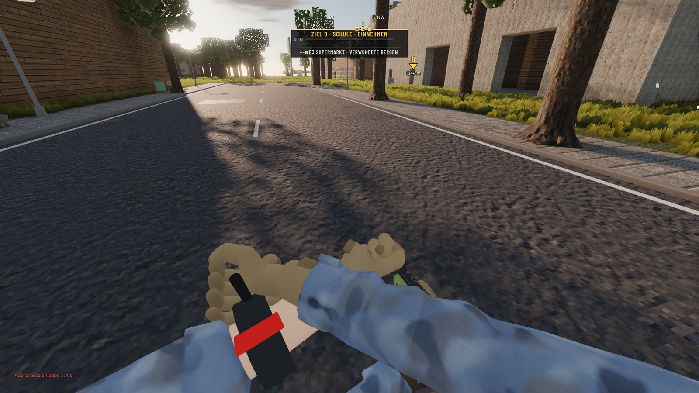 <b>Wounds and field medicine</b> Hits follow wound ballistics: one rifle round to the torso usually puts you down. Bleeding, fractures and chest wounds each need the right fix: tourniquet, pressure bandage, combat gauze, chest seal, splint, morphine or an IV.</td>
</tr>
<tr>
<td width="50%" valign="top">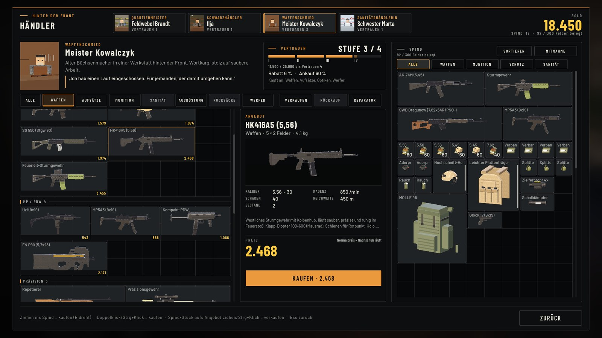 <b>Traders and a war economy</b> Four traders, each with their own stock, trust levels and prices. Prices come from the war itself: destroy a factory and its goods get scarce. The gunsmith repairs plates and helmets.</td>
<td width="50%" valign="top">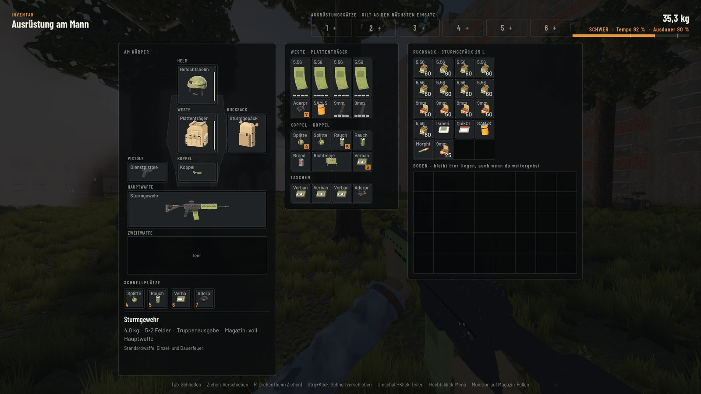 <b>Inventory that matters</b> Grid inventory with backpacks, plate carriers and plates that wear out. Magazines are filled round by round, in real time, while the fight goes on. Weight changes how fast and how loud you move.</td>
</tr>
<tr>
<td width="50%" valign="top">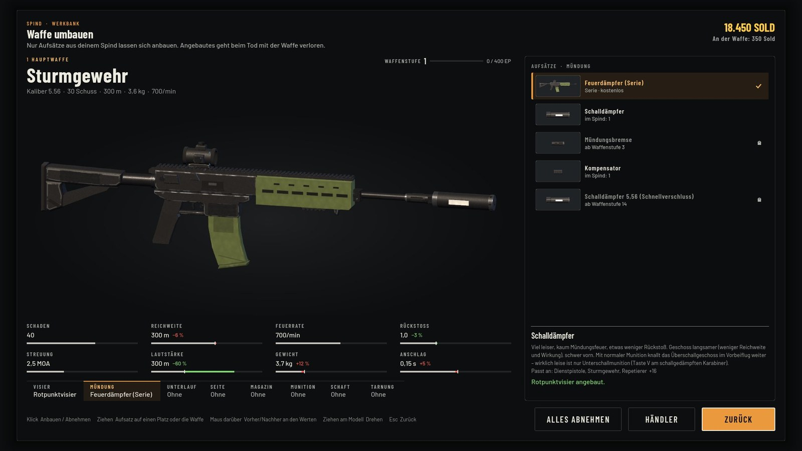 <b>56 weapons, 120+ attachments</b> Every weapon can be bought right away. Attachments unlock with weapon level and go on at the workbench, with a 3D preview and before/after values for recoil, noise, weight and handling.</td>
<td width="50%" valign="top">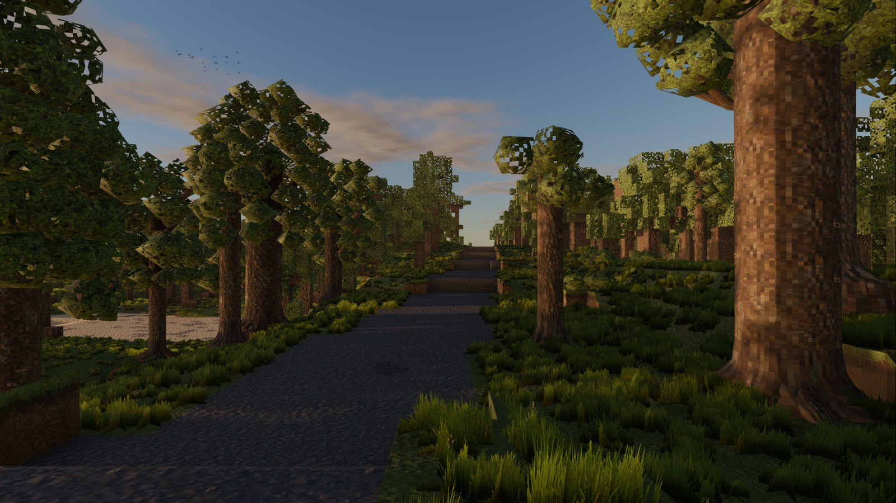 <b>A world built from models</b> Rounded terrain, forests with real trunks and undergrowth, streets, rail yards and industry as proper 3D models. Every wall can still be shot through or blown up.</td>
</tr>
<tr>
<td width="50%" valign="top">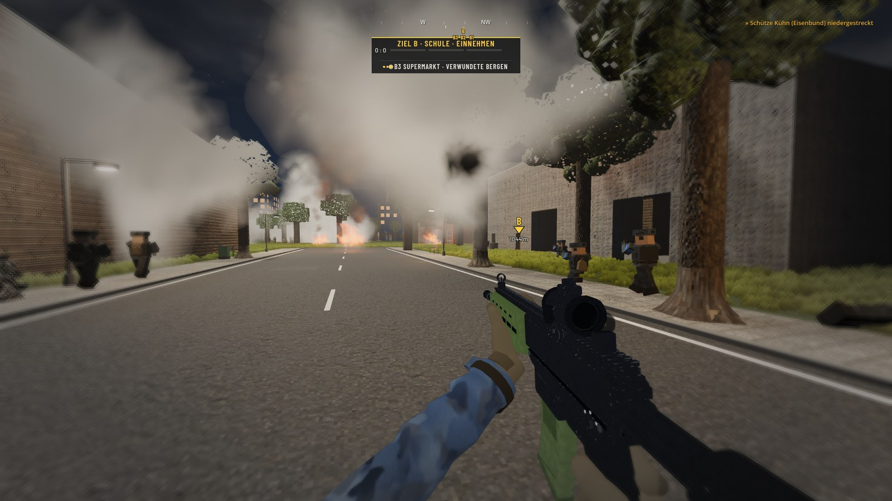 <b>Objectives with history</b> A match runs about 90 minutes over six objectives. Between stages the team votes on the next target. Events like armored pushes, artillery, a downed helicopter or a change in the weather can turn a round.</td>
<td width="50%" valign="top">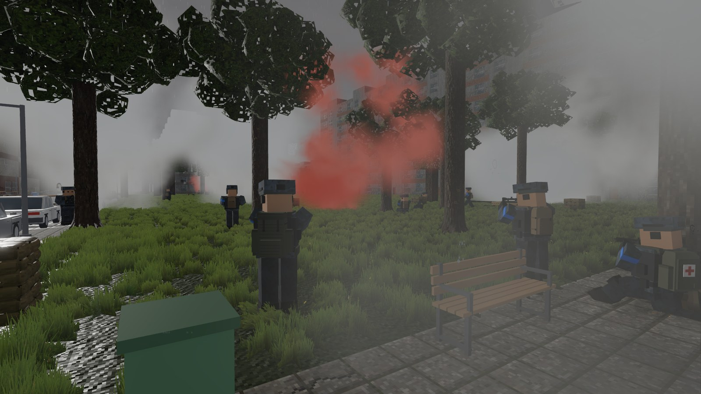 <b>Weather, day and night</b> Rain, fog, snow and darkness cut visibility for you and the AI alike. At night the fighting runs under flares and burning houses.</td>
</tr>
<tr>
<td colspan="2" valign="top">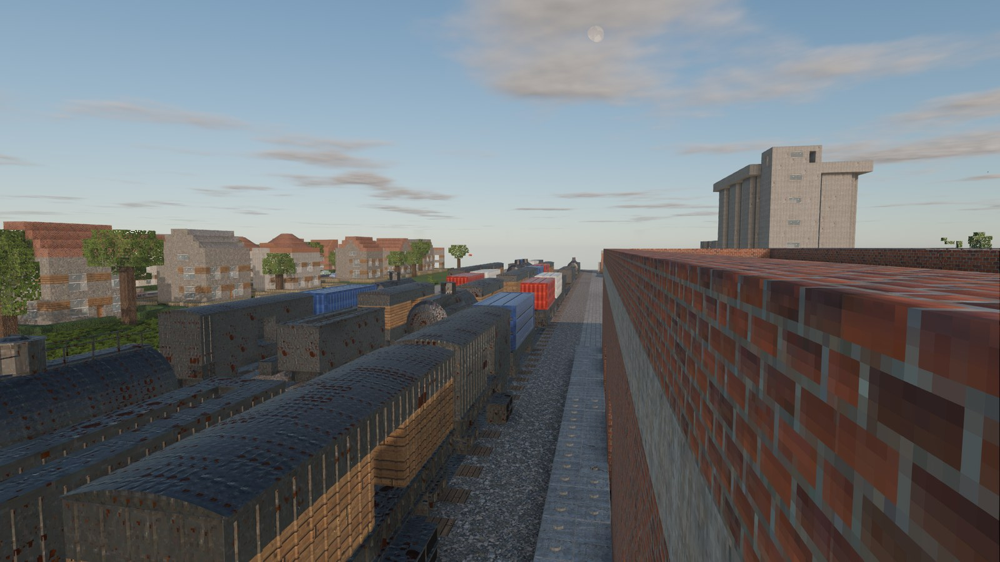 <b>Field promotion</b> Points from a round promote you up to lieutenant. Each rank adds call-ins such as mortar fire, a recon drone, a smoke screen, a transport helicopter, artillery or a single guided round. Dying costs you one rank.</td>
</tr>
</table>

## 🔬 Simulated like the real thing

ATTRITION models the things that decide real firefights instead of hit points and health bars:

* **Wound ballistics.** Damage depends on caliber class and hit zone. One or two rifle hits to the torso usually take you out of the fight, a head hit kills with any caliber. Wounds cause blood loss, shock, fractures and chest wounds.
* **Field medicine after TCCC.** Each injury needs its own fix (tourniquet, pressure bandage, combat gauze, chest seal, splint, morphine, IV), and each treatment takes time while the fight goes on.
* **Armor plates that wear out.** Steel and ceramic plates hold a set number of hits depending on the caliber. Ceramic is lighter but cracks faster; once a plate is through, it is gone.
* **Sound at the speed of sound.** A shot is heard after distance ÷ 343 m/s. When rounds pass close, you hear the supersonic crack first and the muzzle report after it.
* **Bullets that travel.** Shots follow real trajectories and go through thin walls and cover, depending on the material.
* **Real weapon sounds.** Firing sounds are real recordings with several variations per shot, not synthesized effects.
* **AI that has to perceive you.** Soldiers only react to what they see or hear. Distance, light, weather, movement and your silhouette matter: a large backpack or radio pack makes you easier to spot.
* **A war economy.** Trader prices follow supply and demand from the war: destroy a factory and its goods get scarce.
* **Terrain as cover.** Slopes, ditches, walls and buildings block sight and fire, and every wall can be shot through or blown apart.

### The loop

1. **Draw your kit** at the spawn screen: a free standard kit for your role, or your own gear from the locker.
2. **Deploy** and fight for the current objective.
3. **Get paid.** Every kill pays, with a hazard bonus when you were outnumbered, under fire or fighting indoors. Friendly fire costs you.
4. **Loot** the fallen without a loading screen. Kneeling over a body is loud and you are exposed.
5. **Die and lose it**, or get **relieved**: 20 seconds without enemy contact at a base or rally point and your gear goes back into the locker.
6. **Settle up** at the end of the round with a personal statement of everything you earned and lost.

Weapon sound comes from real recordings, with several variations per shot. Distant shots arrive with the delay of the speed of sound: first the crack, then the report.

## 🎮 Game modes

| Mode | |
|---|---|
| **Match** | About 90 minutes, six objectives one after another, all factions fight for the same target. |
| **Faction war** | Pick a faction and join an ongoing war across the whole map. |
| **Lone Wolf** | Alone between the front lines, no commander, no supply. |
| **Co-op** | Two players together in the same war, with shared looting and recovery of a fallen friend's gear. |
| **PvP** | Players only, two teams, up to four players. No gear loss in PvP. |

## 📦 Content

| | |
|---|---|
| Weapons | 56 |
| Attachments & ammo types | 120+ |
| Backpacks | 16 |
| Vests, plates & helmets | 17 |
| Traders | 4 |
| Medical items | 13 |
| Drone types | 5 |
| Factions | 4 |
| Field ranks | 5 (up to lieutenant) |

## 💻 System requirements

| | |
|---|---|
| OS | Windows 10 or 11, 64-bit |
| Graphics | GPU with Vulkan or Direct3D 12 support |
| **Recommended (tested)** | AMD Ryzen 7 7800X3D · NVIDIA GeForce RTX 5070 · 32 GB RAM, aiming for 144 fps on Ultra |
| Older PCs | Use the Medium or Low quality preset |

## ⬇️ Download and updates

1. Download **[ATTRITION-Windows.zip](https://github.com/Vyrenbusiness-source/attrition-releases/releases/latest/download/ATTRITION-Windows.zip)** (one file, ~95 MB).
2. Right-click the zip → **Extract All**.
3. Open the extracted folder and start `ATTRITION.exe`. If Windows shows “Windows protected your PC”, click **More info → Run anyway** (the game is not code-signed yet).

After that the game updates itself. It checks this page at start and in the main menu, downloads only changed files and checks their signature before installing.

## ⌨️ Controls

| Key | Action | Key | Action |
|---|---|---|---|
| W A S D | Move | Tab | Inventory |
| Space / Shift / Ctrl | Jump / sprint / crouch | X | Treat wounds |
| Q / E | Lean | G / H | Grenade / grenade type |
| R | Reload | B | FPV drone |
| F | Interact, loot, vehicles | M | Map |
| 4 – 7 | Quick slots | P (hold) | Scoreboard |

All keys can be rebound in the settings.

## 🆕 Latest updates

Updated automatically from the [releases](https://github.com/Vyrenbusiness-source/attrition-releases/releases). Release notes are written in German.

<!-- updates:en:start -->
| Version | Date | What changed |
|---|---|---|
| [**1.0.238**](https://github.com/Vyrenbusiness-source/attrition-releases/releases/tag/v1.0.238) | Oct 31, 2026 | AI fix: squads that capture a zone now stay and hold it instead of chasing out on searches; rear security moves up to the zone. No more evasive counterattack plans when attacking or defending an objective. |
| [**1.0.237**](https://github.com/Vyrenbusiness-source/attrition-releases/releases/tag/v1.0.237) | Oct 31, 2026 | AI fix: soldiers rescuing a wounded comrade no longer get stuck on wall edges - casualty care starts quickly again; units already in cover hold position instead of shuffling. Building assault entry speed restored. |
| [**1.0.236**](https://github.com/Vyrenbusiness-source/attrition-releases/releases/tag/v1.0.236) | Oct 31, 2026 | Graphics: MSAA 8x and MSAA 16x (8x MSAA + 2x supersampling, for strong GPUs) are now selectable under anti-aliasing. |
| [**1.0.235**](https://github.com/Vyrenbusiness-source/attrition-releases/releases/tag/v1.0.235) | Oct 31, 2026 | Big AI update: squads hold sectors and split fire on multiple threats, fire base keeps suppressing while others flank, counterattacks and ambushes fire together, defenders hold zones in depth, ammo sharing and casualty … |
| [**1.0.234**](https://github.com/Vyrenbusiness-source/attrition-releases/releases/tag/v1.0.234) | Oct 30, 2026 | AI: squads shift fire, bound by fire and movement in open terrain, flank up to the rear, better cover scoring, weapon choice (pistol, anti-tank rules), proper door handling and structured radio reports … |
| [**1.0.233**](https://github.com/Vyrenbusiness-source/attrition-releases/releases/tag/v1.0.233) | Oct 30, 2026 | Photo-real 128 px block and ground textures (no more pixel look), TAA with custom sharpening on High/Ultra (much less shimmer, thin wires stay visible), rounder sights with correct ACOG/PU/1P63 reticles, AI can go prone … |
| [**1.0.232**](https://github.com/Vyrenbusiness-source/attrition-releases/releases/tag/v1.0.232) | Oct 30, 2026 | Round sights and scopes in first person, corrected weapon holding (AI pistols, tripod weapons), new anti-aliasing / render scale / sharpness settings, weapon lighting follows sun/shade/indoors, unified AgX tonemapping … |
| [**1.0.231**](https://github.com/Vyrenbusiness-source/attrition-releases/releases/tag/v1.0.231) | Oct 30, 2026 | Brake and door sounds, covered movement routes for AI squads, shadow flicker fix, tree bark and spruce shapes, co-op fixes, war simulation improvements, fire-base positions. |
<!-- updates:en:end -->

## ❓ FAQ

**Is ATTRITION free?** Yes – completely free, no microtransactions, no account and no launcher. [Download the zip](https://github.com/Vyrenbusiness-source/attrition-releases/releases/latest/download/ATTRITION-Windows.zip), extract it and play.

**Is it like Escape from Tarkov?** It shares the hardcore extraction loop: you risk your own gear, loot bodies, sell to traders and keep only what you bring home. On top of that the whole city is destructible and a war between four factions runs on without you.

**Can I play solo / offline?** Yes. Single-player runs fully offline against AI squads. Co-op and PvP work over the internet or LAN.

**What PC do I need?** Windows 10/11 (64-bit) and a dedicated GPU – see [System requirements](#-system-requirements).

**Is it safe? Windows shows a warning.** The game is not code-signed yet, so SmartScreen warns about an unknown publisher. Click *More info → Run anyway*. Every update is checked against a signature before it is installed.

**Which language?** German for now, English is in progress. Menus and HUD are short and easy to use without German.

## 📜 Credits and licenses

Made with the [Godot Engine](https://godotengine.org) (MIT). Weapon, vehicle and ambient sounds are real recordings: free recordings under CC0, CC BY or public domain, plus purchased sound packs. Every source is credited in the game under *Mitwirkende & Lizenzen*.

## 📣 Share it, stream it

ATTRITION is free, and you are welcome to pass it on. You may share the unmodified game files for free, mirror or re-upload them, and make videos, Let's Plays and streams, monetized or not. You may not sell the game or release a modified version as your own game. All rights stay with the developer, and third-party sounds and textures keep their own licenses. Details are in the [LICENSE](LICENSE).

Found a bug or have an idea? Open an [issue](https://github.com/Vyrenbusiness-source/attrition-releases/issues/new/choose); [CONTRIBUTING](CONTRIBUTING.md) explains what helps most.

⭐ If you enjoyed ATTRITION, <b>star this repo</b> and share it with a friend you want to play co-op with.

---

Keywords: free war game, hardcore shooter, tactical FPS, extraction shooter, military shooter, voxel shooter, destructible environment, AI squads, co-op shooter, PvP, Godot 4, Windows · kostenloses Kriegsspiel, Taktik-Shooter, Hardcore-Shooter
