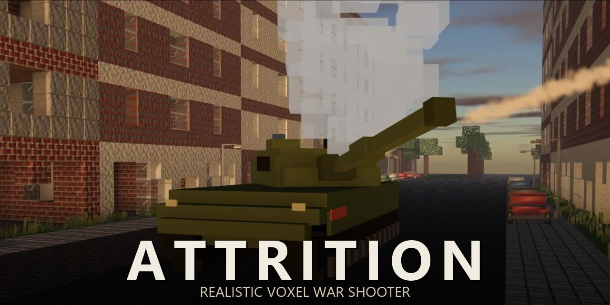
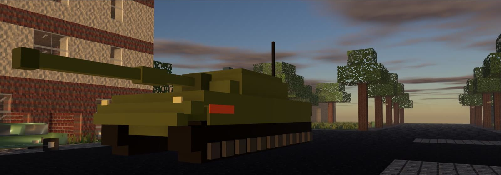
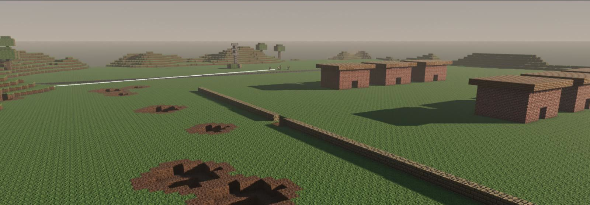
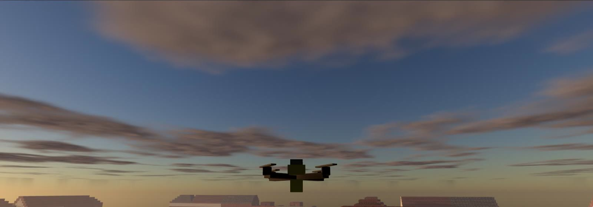
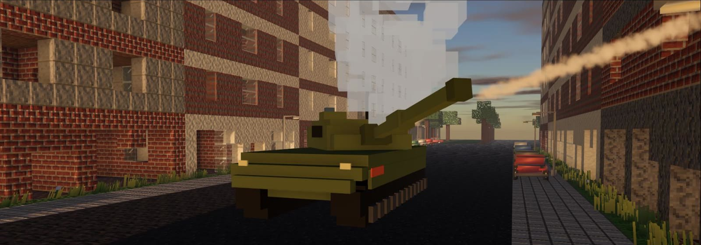
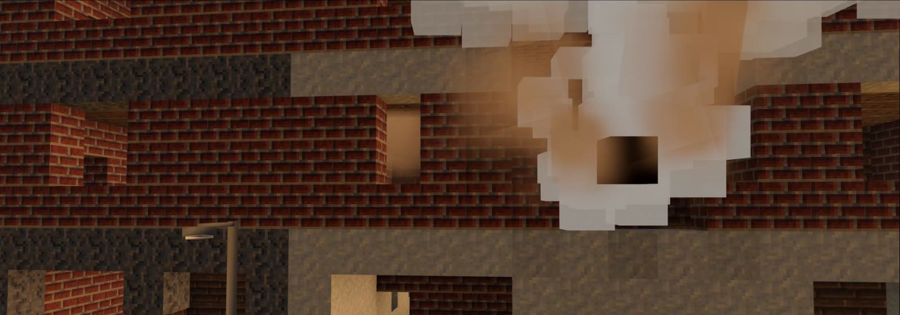
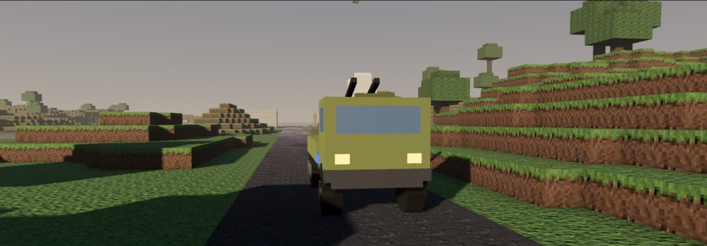
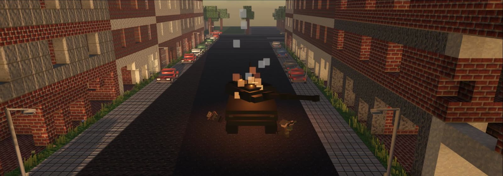

# [>> DOWNLOAD ATTRITION (free, Windows) <<](https://github.com/Vyrenbusiness-source/attrition-releases/releases/latest)

 <b><a href="https://www.youtube.com/watch?v=Mkiqu9hALas">▶ Watch the trailer / Trailer ansehen</a></b>

**English** | [Deutsch](#deutsch)

> **Language:** The game is currently in German. Menus and HUD are simple and easy to follow without German. **English translation coming soon.**

## ATTRITION

**Free realistic war game for Windows – a tactical FPS / military shooter in a fully destructible voxel world.** You are one soldier in a war that keeps going without you. Hundreds of AI soldiers, tanks and drones fight across towns and fields, and one bad step into the open can end your run.

## About

Walls come down. Houses burn. A tank turns the corner and the street you were holding is gone. ATTRITION is a free singleplayer and co-op war shooter where the map changes with every shell, every grenade and every drone strike.

You start as a rifleman with a few magazines. Over 50 ranks you unlock new rifles, optics, drones and vehicles. The enemy does not wait for you: squads pin you down, move around your flank, throw a grenade through the window and wait in ambush when you chase them.

## Built on Real Data

Realism is the core of ATTRITION. Every projectile flies with real ballistics – muzzle velocity, drag, drop and penetration taken from published data for each cartridge. Weapons use manufacturer specifications (rate of fire, weight, magazine, sights), and vehicles and blast effects follow published military and scientific sources. The effect of suppressive fire is based on research into how bullet energy and the supersonic crack affect soldiers. AI squads fight by real infantry doctrine: fire and movement, flanking, room clearing, ambushes and counter-attacks – and they only know what they can see or hear.

## Key Features

- **Total destruction.** Voxel terrain and buildings can be shot, blown up and dug through.
- **AI armies.** Commanders and squads follow a doctrine for each faction and fight each other as well as you.
- **Real weapon sounds.** Weapon audio is built from real recordings (CC0, CC BY and public domain sources), with several variations per shot.
- **Drones.** Scout, strike and FPV drones, and jammers against them.
- **Vehicles and aircraft.** Drive tanks and trucks, fly helicopters, share seats with friends.

- **Co-op.** Play the war together with friends.
- **Progression.** 50 player levels with unlocks and a loadout menu.
- **Weather and time of day.** Sun, rain, fog and night change how fights play out.

## Game Modes

- **Faction war.** Fight for the Eisenbund against the other three factions in a large, persistent war.
- **Match mode.** Round-based matches with capture objectives on prepared maps.
- **Co-op.** Join friends in the same war.

## Factions

Eisenbund (heavy industry), Freie Grenzer (guerrilla), Nordwacht (defense) and Kupferkartell (technology and air).

## Content

| | |
|---|---|
| Weapons | 35 |
| Vehicles | 10 |
| Drone types | 5 |
| Factions | 4 |
| Player levels | 50 |

## System Requirements

- Windows 10 or 11, 64-bit
- A graphics card with Vulkan or DirectX 12 support
- **Recommended (tested):** AMD Ryzen 7 7800X3D, NVIDIA GeForce RTX 5070, 32 GB RAM – targets 144 fps on Ultra
- Lower-end PCs: use the Medium/Low quality presets

## Controls

| Key | Action |
|---|---|
| W A S D | Move |
| Space / Shift / Ctrl | Jump / sprint / crouch |
| Q / E | Lean left / right |
| R | Reload |
| F | Interact, enter vehicles |
| G / H | Grenade / grenade type |
| B | Launch drone |
| X | Heal |
| M | Map |
| Tab | Scoreboard |

All keys can be rebound in the game.

## Updates

ATTRITION updates itself. New versions are downloaded from this page and are signed, so only genuine releases are installed.

## Credits

Built with the [Godot Engine](https://godotengine.org). Weapon sounds from CC0, CC BY and public domain recordings; individual credits are listed in the game.

---

# [>> ATTRITION HERUNTERLADEN (kostenlos, Windows) <<](https://github.com/Vyrenbusiness-source/attrition-releases/releases/latest)

[English](#attrition) | **Deutsch**

## ATTRITION

**Kostenloses, realistisches Kriegsspiel für Windows – ein taktischer Shooter in einer komplett zerstörbaren Voxel-Welt.** Du bist ein Soldat in einem Krieg, der auch ohne dich weiterläuft. Hunderte KI-Soldaten, Panzer und Drohnen kämpfen um Dörfer und Städte, und ein falscher Schritt ins Freie kann das Ende sein.

> **Sprache:** Das Spiel ist derzeit auf Deutsch. Englische Übersetzung folgt bald.

## Über das Spiel

Wände stürzen ein, Häuser brennen, ein Panzer biegt um die Ecke – und die Straße, die du gehalten hast, gibt es nicht mehr. ATTRITION ist ein kostenloser Kriegsshooter für Einzelspieler und Koop, in dem sich die Karte mit jeder Granate und jedem Drohnenangriff verändert.

Du startest als Schütze mit ein paar Magazinen. Über 50 Stufen schaltest du neue Gewehre, Optiken, Drohnen und Fahrzeuge frei. Der Gegner wartet nicht: Trupps halten dich nieder, umgehen dich, werfen eine Granate durchs Fenster und lauern dir auf, wenn du nachsetzt.

## Auf echten Daten gebaut

Realismus ist der Kern von ATTRITION. Jedes Projektil fliegt mit echter Ballistik – Mündungsgeschwindigkeit, Luftwiderstand, Geschossabfall und Durchschlag nach veröffentlichten Daten der jeweiligen Patrone. Waffen nutzen Herstellerangaben (Kadenz, Gewicht, Magazin, Visiere), Fahrzeuge und Sprengwirkung folgen veröffentlichten militärischen und wissenschaftlichen Quellen. Die Wirkung von Niederhaltefeuer beruht auf Studien dazu, wie Geschossenergie und Überschallknall auf Soldaten wirken. KI-Trupps kämpfen nach echter Infanterie-Doktrin: Feuer und Bewegung, Umfassen, Häuserkampf, Hinterhalte und Gegenstöße – und sie wissen nur, was sie sehen oder hören.

## Hauptmerkmale

- **Totale Zerstörung.** Voxel-Gelände und Gebäude lassen sich beschießen, sprengen und untergraben.
- **KI-Armeen.** Kommandanten und Trupps folgen der Doktrin ihrer Fraktion und bekämpfen sich gegenseitig und dich.
- **Echte Waffenklänge.** Der Waffenton stammt aus echten Aufnahmen (CC0, CC BY und gemeinfrei), mit mehreren Varianten je Schuss.
- **Drohnen.** Aufklärungs-, Angriffs- und FPV-Drohnen sowie Störsender dagegen.
- **Fahrzeuge und Luftfahrzeuge.** Panzer und Laster fahren, Hubschrauber fliegen, Sitze mit Freunden teilen.
- **Koop.** Den Krieg gemeinsam mit Freunden spielen.
- **Fortschritt.** 50 Spielerstufen mit Freischaltungen und Ausrüstungsmenü.
- **Wetter und Tageszeit.** Sonne, Regen, Nebel und Nacht verändern den Kampf.

## Spielmodi

- **Fraktionskrieg.** Kämpfe für den Eisenbund gegen die drei anderen Fraktionen in einem großen, dauerhaften Krieg.
- **Match-Modus.** Rundenbasierte Matches mit Einnahmezielen auf vorbereiteten Karten.
- **Koop.** Tritt mit Freunden demselben Krieg bei.

## Fraktionen

Eisenbund (Schwerindustrie), Freie Grenzer (Guerilla), Nordwacht (Verteidigung) und Kupferkartell (Technik und Luft).

## Inhalt

| | |
|---|---|
| Waffen | 35 |
| Fahrzeuge | 10 |
| Drohnentypen | 5 |
| Fraktionen | 4 |
| Spielerstufen | 50 |

## Systemvoraussetzungen

- Windows 10 oder 11, 64-Bit
- Grafikkarte mit Vulkan- oder DirectX-12-Unterstützung
- **Empfohlen (getestet):** AMD Ryzen 7 7800X3D, NVIDIA GeForce RTX 5070, 32 GB RAM – Ziel 144 fps auf Ultra
- Schwächere PCs: Qualitätsstufen Mittel/Niedrig nutzen

## Steuerung

| Taste | Aktion |
|---|---|
| W A S D | Bewegen |
| Leertaste / Shift / Strg | Springen / Sprinten / Ducken |
| Q / E | Nach links / rechts lehnen |
| R | Nachladen |
| F | Benutzen, Fahrzeuge betreten |
| G / H | Granate / Granatentyp |
| B | Drohne starten |
| X | Heilen |
| M | Karte |
| Tab | Punktetafel |

Alle Tasten lassen sich im Spiel neu belegen.

## Aktualisierungen

ATTRITION aktualisiert sich selbst. Neue Versionen werden von dieser Seite geladen und sind signiert, damit nur echte Veröffentlichungen installiert werden.

## Danksagung

Gebaut mit der [Godot Engine](https://godotengine.org). Waffenklänge aus CC0-, CC-BY- und gemeinfreien Aufnahmen; die einzelnen Nachweise stehen im Spiel.

---
Keywords: free war game, realistic shooter, tactical FPS, military simulation, voxel shooter, destructible environment, Godot 4 game, drone warfare, tank combat, co-op shooter, indie game, Windows · kostenloses Kriegsspiel, realistischer Shooter, Taktik-Shooter
