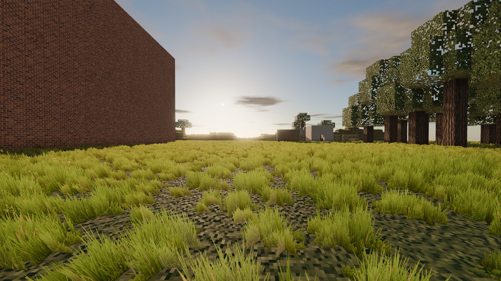
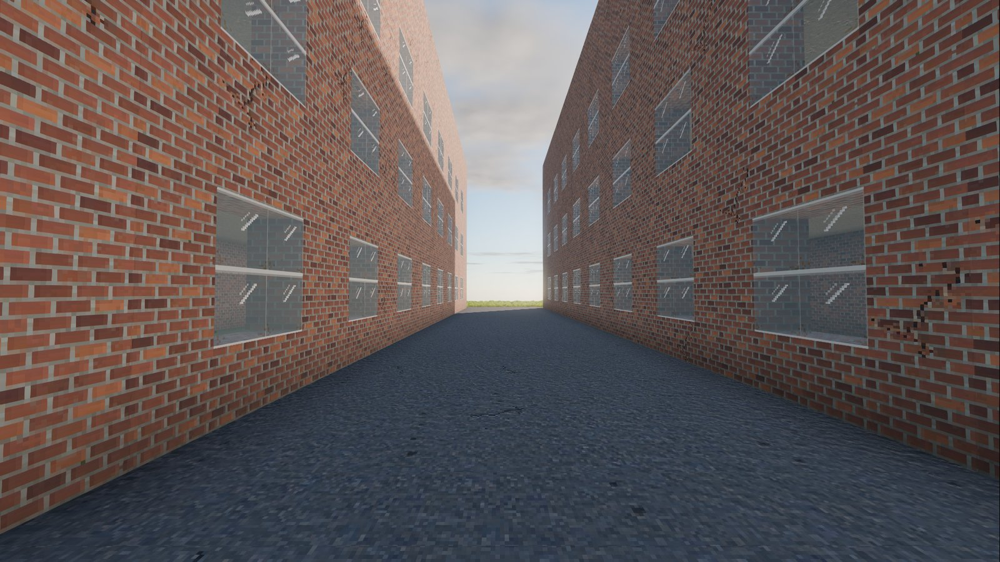
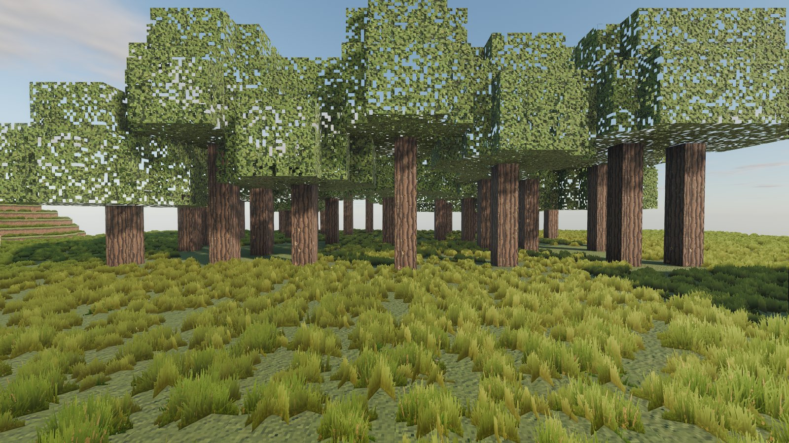
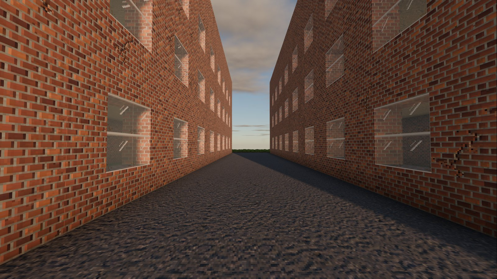
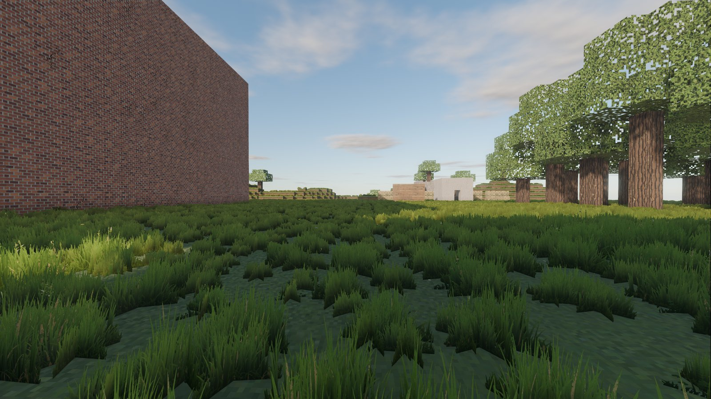

# [>> DOWNLOAD ATTRITION (free, Windows) <<](https://github.com/Vyrenbusiness-source/attrition-releases/releases/latest)

**English** | [Deutsch](#deutsch)

## ATTRITION

A realistic voxel war shooter. Four factions fight over a destructible world, commanded by AI that plans, flanks and adapts. You fight as one soldier among hundreds, on foot, in vehicles, in the air, or through a drone feed.

## About

ATTRITION is a free, single-player and co-op shooter built on a fully destructible voxel world. Every wall, floor and bridge can be broken, and the battlefield changes with every shell.

You join the war as a rifleman, level up through 50 ranks, unlock gear, and take on larger roles: drone operator, vehicle crew, pilot. The enemy does not stand still and wait. AI squads use cover, suppress, flank and call for support.

## Key Features

- **Total destruction.** Voxel terrain and buildings can be shot, blown up and dug through.
- **AI armies.** Commanders and squads follow a doctrine for each faction and fight each other as well as you.
- **Real weapon sounds.** Weapon audio is built from real recordings (CC0, CC BY and public domain sources), with several variations per shot.
- **Drones.** Scout, strike and FPV drones, and jammers against them.
- **Vehicles and aircraft.** Drive tanks and trucks, fly helicopters, share seats with friends.

- **Co-op.** Play the war together with friends.
- **Progression.** 50 player levels with unlocks and a loadout menu.
- **Weather and time of day.** Sun, rain, fog and night change how fights play out.

## Game Modes

- **Faction war.** Fight for the Eisenbund against the other three factions in a large, persistent war.
- **Match mode.** Round-based matches with capture objectives on prepared maps.
- **Co-op.** Join friends in the same war.

## Factions

Eisenbund (heavy industry), Freie Grenzer (guerrilla), Nordwacht (defense) and Kupferkartell (technology and air).

## Content

| | |
|---|---|
| Weapons | 35 |
| Vehicles | 10 |
| Drone types | 5 |
| Factions | 4 |
| Player levels | 50 |

## System Requirements

- Windows 10 or 11, 64-bit
- A graphics card with Vulkan or DirectX 12 support
- Exact minimum hardware figures will be added after more testing

## Controls

| Key | Action |
|---|---|
| W A S D | Move |
| Space / Shift / Ctrl | Jump / sprint / crouch |
| Q / E | Lean left / right |
| R | Reload |
| F | Interact, enter vehicles |
| G / H | Grenade / grenade type |
| B | Launch drone |
| X | Heal |
| M | Map |
| Tab | Scoreboard |

All keys can be rebound in the game.

## Updates

ATTRITION updates itself. New versions are downloaded from this page and are signed, so only genuine releases are installed.

## Credits

Built with the [Godot Engine](https://godotengine.org). Weapon sounds from CC0, CC BY and public domain recordings; individual credits are listed in the game.

---

# [>> ATTRITION HERUNTERLADEN (kostenlos, Windows) <<](https://github.com/Vyrenbusiness-source/attrition-releases/releases/latest)

[English](#attrition) | **Deutsch**

## ATTRITION

Ein realistischer Voxel-Kriegs-Shooter. Vier Fraktionen kämpfen um eine zerstörbare Welt, geführt von einer KI, die plant, umgeht und sich anpasst. Du kämpfst als ein Soldat unter Hunderten, zu Fuß, im Fahrzeug, in der Luft oder über eine Drohnenkamera.

## Über das Spiel

ATTRITION ist ein kostenloser Shooter für Einzelspieler und Koop auf einer vollständig zerstörbaren Voxel-Welt. Jede Wand, jeder Boden und jede Brücke lässt sich zerstören, und das Schlachtfeld verändert sich mit jeder Granate.

Du beginnst als Schütze, steigst durch 50 Stufen auf, schaltest Ausrüstung frei und übernimmst größere Rollen: Drohnenführer, Fahrzeugbesatzung, Pilot. Der Gegner wartet nicht auf dich. KI-Trupps nutzen Deckung, unterdrücken, umgehen und rufen Unterstützung.

## Hauptmerkmale

- **Totale Zerstörung.** Voxel-Gelände und Gebäude lassen sich beschießen, sprengen und untergraben.
- **KI-Armeen.** Kommandanten und Trupps folgen der Doktrin ihrer Fraktion und bekämpfen sich gegenseitig und dich.
- **Echte Waffenklänge.** Der Waffenton stammt aus echten Aufnahmen (CC0, CC BY und gemeinfrei), mit mehreren Varianten je Schuss.
- **Drohnen.** Aufklärungs-, Angriffs- und FPV-Drohnen sowie Störsender dagegen.
- **Fahrzeuge und Luftfahrzeuge.** Panzer und Laster fahren, Hubschrauber fliegen, Sitze mit Freunden teilen.
- **Koop.** Den Krieg gemeinsam mit Freunden spielen.
- **Fortschritt.** 50 Spielerstufen mit Freischaltungen und Ausrüstungsmenü.
- **Wetter und Tageszeit.** Sonne, Regen, Nebel und Nacht verändern den Kampf.

## Spielmodi

- **Fraktionskrieg.** Kämpfe für den Eisenbund gegen die drei anderen Fraktionen in einem großen, dauerhaften Krieg.
- **Match-Modus.** Rundenbasierte Matches mit Einnahmezielen auf vorbereiteten Karten.
- **Koop.** Tritt mit Freunden demselben Krieg bei.

## Fraktionen

Eisenbund (Schwerindustrie), Freie Grenzer (Guerilla), Nordwacht (Verteidigung) und Kupferkartell (Technik und Luft).

## Inhalt

| | |
|---|---|
| Waffen | 35 |
| Fahrzeuge | 10 |
| Drohnentypen | 5 |
| Fraktionen | 4 |
| Spielerstufen | 50 |

## Systemvoraussetzungen

- Windows 10 oder 11, 64-Bit
- Grafikkarte mit Vulkan- oder DirectX-12-Unterstützung
- Genaue Mindestanforderungen folgen nach weiteren Tests

## Steuerung

| Taste | Aktion |
|---|---|
| W A S D | Bewegen |
| Leertaste / Shift / Strg | Springen / Sprinten / Ducken |
| Q / E | Nach links / rechts lehnen |
| R | Nachladen |
| F | Benutzen, Fahrzeuge betreten |
| G / H | Granate / Granatentyp |
| B | Drohne starten |
| X | Heilen |
| M | Karte |
| Tab | Punktetafel |

Alle Tasten lassen sich im Spiel neu belegen.

## Aktualisierungen

ATTRITION aktualisiert sich selbst. Neue Versionen werden von dieser Seite geladen und sind signiert, damit nur echte Veröffentlichungen installiert werden.

## Danksagung

Gebaut mit der [Godot Engine](https://godotengine.org). Waffenklänge aus CC0-, CC-BY- und gemeinfreien Aufnahmen; die einzelnen Nachweise stehen im Spiel.
